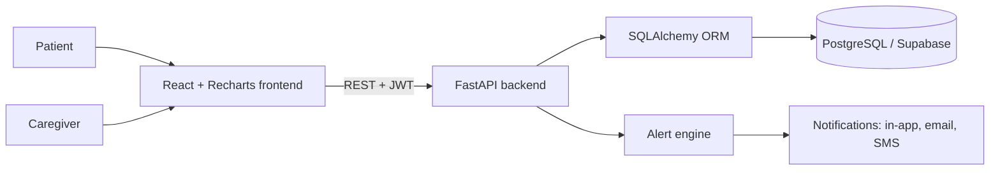

# CareChrono

**Your Health. Your Journey. Every Change Matters.**

CareChrono is a patient-centred web app for people living with chronic conditions such as diabetes, hypertension and heart disease. It goes beyond storing medical files: it shows patients **what changed between consultations**, tracks their readings over time, reminds them about medication, and can alert a nominated caregiver when attention may be needed, with the patient's consent.

> CareChrono supports patients and is **not a substitute for medical advice**. It never diagnoses. Alerts only say that "attention may be needed".


## The problem

People with chronic conditions often switch doctors and carry a bag of scattered prescriptions, lab reports and scans. Storage apps exist, but they only hold files. Patients still cannot tell what has changed between visits, whether their readings are improving, or when something needs attention. Elderly patients living alone have the added risk that nobody notices a problem in time.

## The solution

CareChrono is **patient-owned**. The patient keeps their whole history in one place, shares it only by choice, and gets plain-language insight into how their health is changing.

## Key features

- **Unified health records:** prescriptions, reports, scans and consultations in one searchable timeline, plus a read-only "Share with new doctor" link that expires after 24 hours (no doctor login needed).
- **Consultation comparison:** side-by-side view of readings, symptoms and medication changes between any two visits, with a plain-language "what changed" summary.
- **Continuous monitoring:** quick logging of BP, glucose, weight, heart rate and SpO2 with trend charts.
- **Medication reminders:** daily schedule, taken/skipped tracking and adherence.
- **My Targets and smart alerts:** the patient enters the targets given by their own doctor; general guideline defaults are clearly labelled. Fixed safety limits for critical readings cannot be edited or disabled.
- **Senior Mode:** a simple, high-contrast screen with a daily check-in and an SOS button.
- **Caregiver alerts with consent:** caregivers see alerts only after the patient grants access, and the patient can revoke it at any time.
- **Health Bloom:** a flower on the dashboard that blooms as the patient keeps up with readings and medication.

## Tech stack

| Layer | Technology |
| --- | --- |
| Frontend | React (Vite), Tailwind CSS, Recharts |
| Backend | Python, FastAPI, Pydantic |
| Database | PostgreSQL (Supabase) via SQLAlchemy |
| Auth | JWT, roles: patient and caregiver |

## Architecture



## Project structure

```
Carechrono/
├── backend/          FastAPI app, models, routes, seed script
├── frontend/         React (Vite) app
│   └── src/
│       ├── components/   BottomNav, HealthBloom, LogReadingModal, Navbar...
│       ├── context/      AuthContext
│       └── pages/        Dashboard, HealthRecordsPage, ConsultationCompare,
│                         ContinuousMonitoring, MedicationsPage,
│                         MyTargetsAndAlertsPage, SeniorModeView,
│                         CaregiverConsentPage, SharedDoctorSummary
├── .env.example      Environment variable template
└── README.md
```

## Getting started

### Prerequisites

- Python 3.10 or newer
- Node.js 18 or newer
- A Supabase project (or any PostgreSQL database)

### 1. Clone

```bash
git clone https://github.com/YOUR-USERNAME/carechrono.git
cd carechrono
```

### 2. Configure environment variables

Copy `.env.example` to `.env` and fill in your own values. **Never commit your real `.env` file.**

```bash
# Windows (PowerShell)
copy .env.example .env

# macOS / Linux
cp .env.example .env
```

### 3. Run the backend

```bash
cd backend
python -m venv .venv

# Windows (PowerShell)
.venv\Scripts\activate
# macOS / Linux
source .venv/bin/activate

pip install -r requirements.txt
python seed.py                    # loads the demo data
uvicorn main:app --reload         # API on http://localhost:8000
```

API docs are available at `http://localhost:8000/docs`.

> If your entry file is not `main.py`, change `main:app` to match your project.

### 4. Run the frontend

In a second terminal:

```bash
cd frontend
npm install
npm run dev                       # app on http://localhost:5173
```

## Demo data

`seed.py` creates a demo patient with Type 2 diabetes and hypertension, a caregiver with consent already granted, several consultations over 12 months, about 90 days of readings and sample documents. Use the "Try demo" buttons on the landing page or the seeded demo logins.

Try this flow:

1. Open **Compare** and pick two consultations to see what changed.
2. Open **Monitoring** to see the trend charts.
3. Log a BP reading of **190/125**. A critical alert appears and the caregiver can see it.
4. Switch on **Senior Mode** and try the SOS button.

> In demo mode, SMS and email are simulated and shown in the app instead of being sent. Real delivery needs your own provider keys in `.env`.

## Safety and privacy

- CareChrono never diagnoses. Alert wording is always "attention may be needed".
- Critical safety limits (BP at or above 180/120, glucose below 70 or above 250) always trigger an alert and cannot be edited or turned off.
- Caregiver access requires the patient's explicit consent and can be revoked at any time.
- Doctor access is a read-only, time-limited share link created by the patient.
- This is a hackathon prototype using simulated data. It is not a certified medical device.

## Roadmap

- Bluetooth glucometer and BP monitor sync
- Lab-report OCR to fill records automatically
- Hindi and Telugu interface for senior users
- Optional AI plain-language summaries

## Team

Built for a  hackathon by Team Visioneers

